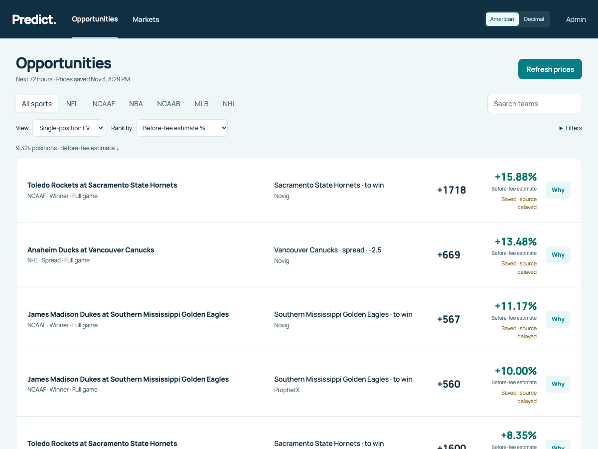

# Predict — integrated engineering verification, November 3, 2026

The ordinary **capture → match → calculate → display → replace** product is
integrated in the sole main checkout. The approved navy/teal Manrope interface,
matching repairs, named reference selection and distinct fee scenarios are running
at `http://127.0.0.1:8783/`. Owner acceptance is separate from this engineering
verification. No commit, push, trading, provider correspondence, installer or
hosting work occurred. Existing uncommitted work and saved settings were preserved.

## Delivered repairs

- Snapshot occurrence matching now applies the existing exact-schedule, unique
  participant-role association to missing-context rows in all six leagues. It
  retains source predicates, thresholds, overtime evidence and ambiguity checks.
  The NCAAB overtime assumption stays confined to NCAAB. Failed optional equality
  projection preserves verified source-local decisive math; it does not promote
  unknown cross-instrument equivalence.
- Replaying the original 9,265-position input recovers **132 NCAAF positions**
  from missing context, reduces unmatched positions from 4,776 to **4,644**, and
  increases opposing pairs from 507 to **609**. All **838 existing gross values
  remain exactly equal**. These are fixed-input comparisons, not changes caused
  by new prices or games entering/leaving the horizon.
- Novig and ProphetX reference choices now use their own exact two-sided captured
  witnesses. They no longer accept a selection that can only return unavailable.
  Source receipt, clock coherence, signed line, occurrence and reference identity
  checks remain. Missing chosen-book pairs never fall back to Pinnacle.
- The ordinary snapshot exposes the existing reviewed trade-fee calculation as
  a separate **After trade-fee estimate** metric. It neither replaces gross EV
  nor treats the owner's blank upfront-fee assumptions as zero. The prospective
  November 3 fee reviews preserve historical expiry gaps and retain the official
  [Novig fee schedule](https://support.novig.com/en/articles/16195057-fees-on-novig)
  and [Polymarket US fee documentation](https://docs.polymarket.us/fees).
- Game catalogs retain names when source buckets merge or split. Cards use full
  source participant names. Why explains offered/fair odds and the $100 example;
  funding, formulas and literal evidence remain in Admin. The selected metric
  survives the game and Admin inspection links. Restore defaults now populates
  the form and waits for Recalculate before saving.
- Admin distinguishes the recovery gate from acquisition: a pending aggregate
  request can temporarily prevent replacement while the running owner continues
  acquiring. No accounting state was cleared to remove a warning.

## Authentic captured result and arithmetic

Input `37732bc8508746369c6d6e0c933a8473` was captured at **20:29:04 Eastern**
on November 3. The refreshed result and subsequent unchanged-settings recalculation
contain **9,324 execution positions**, **1,016 before-fee estimates**, **604 reviewed
trade-fee estimates**, **503 opposing pairs**, and **4,505 unmatched positions**.
All captured original price values matched their retained Original records.
No catalog errors were returned. Pinnacle stays reference-only.

| League | Kalshi | Polymarket US | Novig | ProphetX |
| --- | ---: | ---: | ---: | ---: |
| NFL | 92 | 142 | 132 | 6 |
| NCAAF | 192 | 270 | 998 | 48 |
| NBA | 1,804 | 1,557 | 1,352 | 634 |
| NCAAB | 247 | 270 | 308 | 342 |
| MLB | 0 | 0 | 0 | 0 |
| NHL | 492 | 266 | 154 | 18 |

MLB remained configured and requested; this capture contained no next-72-hour
MLB position. This is not a claim that providers never offer MLB markets.

Independent rational arithmetic checked **every one of the 1,016 numeric gross
results** against its exact reference pair and acquisition cost. Examples:

- Sacramento State to win at Novig: decimal 18.18 (+1718), Pinnacle 1.03/15.13,
  decisive probability `103/1616`, fair decimal `1616/103` (American +1468.93).
  `100 × ((103/1616) × 18.18 − 1) = 15.875%`, displayed **15.88%**.
  The $100 example has $1,718 decisive-win profit and $100 decisive-loss exposure.
  Its reviewed zero pregame trade-fee scenario has the same 15.875% value.
- Southern Mississippi to win at ProphetX: decimal 6.60, reference 1.15/5.75,
  probability `1/6`, gross `100 × ((1/6) × 6.60 − 1) = 10%`.
  Its trade-fee estimate remains unavailable because the applicable account fee
  model and rate are unbound.
- Separate explicit, unsaved test assumptions (zero upfront fees, fractional
  top-price sizing, decisive-only states, original $1,000 and 0.5% buffer) produce
  **1,016 net results and 660 opposing minima**. Each net result equals gross
  return minus 0.5 percentage points; each minimum equals
  `100 × (1 / (cost₁ + cost₂) − 1) − 0.5`. Every result was independently checked.
- Authored fee arithmetic: at probability 0.60 and contract cost $0.50, Polymarket
  US's one-contract/one-fill taker fee rounds $0.017375 to $0.02; risk is $0.52,
  expected profit $0.08, return `200/13%`. This normalizes one fill; it is not the
  fee for an actual $100 order. Half-even cent ties and review expiry are tested.
- Authored funded arithmetic: $1,020 funding, price $0.50, 2% upfront fee buys
  2,000 claims. At probability 0.60, $180 expected profit less a single $5.10
  buffer gives $174.90. Opposing costs 0.40/0.50 with $1,000 funding and 0.5%
  buffer give minimum `$955/9`; a modeled acquisition refund gives −$5 minimum,
  with EV unavailable until the exceptional-state probability is supplied.

The owner's saved $1,000 funding, 0.5% buffer, Pinnacle reference and unspecified
fees/scenario/scoring/sizing remain unchanged. **Zero numeric assumed-net and
scenario-minimum outputs under those saved settings are intentional unknowns.**
The listed 503 pairs are possible opposing-position comparisons, not 503 numeric
or executable arbitrages.

## Exact remaining input dependencies

| Missing evidence | Affected behavior | Minimum input needed |
| --- | --- | --- |
| Scoring scope on 3,838 captured positions | Cross-instrument equality and dependent comparisons remain unsupported | Source-bound full-game scoring/overtime treatment for the exact market class; generic league convention is insufficient |
| Equality treatment on 667 positions | Push/tie/threshold equality cannot be treated as a known payout | Exact predicate/equality evidence, or an explicitly chosen applicable conditional scenario |
| Exact chosen-book two-sided witness | No probability or EV for that row | Same occurrence, market/line and coherent receipt from the chosen reference book |
| ProphetX fee model/rate on 412 otherwise numeric gross positions | Reviewed trade-fee estimate unavailable | Applicable account fee model and rate bound to that instrument/use |
| Kalshi exact instrument fee schedule | No blanket reviewed fee scenario | Applicable series/event override and rounding evidence; the old HOU–JAC-specific operation does not establish fees for new events |
| Owner fee/scenario/sizing settings; exceptional probability where applicable | Assumed net EV and opposing minimum outputs | Explicit settings in Admin; blank inputs remain unknown |
| Actual fill size/depth and exceptional settlement certification | No executable/guaranteed return claim | Instrument-specific evidence beyond the defined snapshot scenario product |

The Novig scope boundary was checked against current primary documentation:
[Market Rules](https://support.novig.com/en/articles/9612523-market-rules) now points
to Ludlow contracts. The published
[NBA spread terms](https://ludlow-filings.s3.us-east-1.amazonaws.com/NBA-spread-anchor-2.0-a.pdf)
and [class certification](https://ludlow-filings.s3.us-east-1.amazonaws.com/NBA-Spread-Class-Certification.pdf)
include overtime for Full Game and extend the terms to listings in that class.
However, the retained aggregate records do not identify the Ludlow class/listing
or establish that channel mapping. The class also includes other time periods.
The exact remaining dependency is feed-to-contract-class and period applicability,
not the existence of published NBA rules. That missing binding was not inferred
from the brand name, nor was fair-value void settlement treated as a refund.

The independent snapshot engineering is complete; these dependencies are not
substituted with guessed values. Continuous per-tick publication, scanner capacity,
99% provider coverage and sustained streaming qualification remain separately
scoped follow-ons under the current product specification.

## Source behavior and accounting

At 20:33:49 Eastern, the prior owner had healthy heartbeat and active dispatch,
with both native sources receiving books. Kalshi had all 5,845 subscribed initial
images; Polymarket US had all 8,557. Derived admission lag was still material:
respective sampled p95 delays were 86.6 and 34.5 seconds, with 3,499 and 8,086
pending derived images. These are not current-price or coverage guarantees.
Novig/ProphetX were waiting for their shared 15-minute cycle, correctly labeled
budget-delayed; successful recent aggregate receipts were retained. Pinnacle was
collected solely as a reference.

The source-census artifact distinguishes durable raw images/outcomes, normalized
next-72-hour offers, immutable captured positions, 4,819 positions with supported comparison
identity (3,481 distinct groups, including 1,338 groups spanning venues),
2,676 numeric price differences, 1,016 probability-and-price-supported gross results and complete
9,324-position display pagination. Raw image counts span retained generations
and use markets rather than side positions; aggregate raw counts cover a broader
horizon. They are not interchangeable denominators. Native pending images are
not silently counted as normalized or displayed new prices. Original clocks
remain distinct from capture time, successful confirmation and last price change.

The nine old uncertain attempts retain **23 credits** of exposure. The existing
November account rollover/conservative-recovery evidence already covers them;
no current blocking accounting reason was present. No speculative reconciliation,
hold release, balance import or source-pause change was performed. Usage rose
through authorized scheduled acquisition. The account window, reserve and
300-credit/cycle and 16,800-credit/day guards remain in force.

At 20:36 the normal app and data processes were stopped and restarted in place.
The final running-source and protected-state check is recorded below after native
restoration. The 20:36 read-only census measured database size **1,823,548,195
bytes**, below the 2 GiB guard. Existing online maintenance and startup recovery
remain responsible for reclaiming replaceable storage; no guard was raised.

## Verification and observed performance

- All 9,324 rows were retrieved through real HTTP pagination once each, in the
  independent expected gross ordering. All four single-position rankings were
  checked across full pagination, including deterministic tie keys and nulls last.
- Authentic browser journey: Opportunities → keyboard Why → game → exact Admin
  inspection → back; selected calculation and link focus restored. American/Decimal
  preference persisted across navigation and reload, without changing math.
  Full-name/abbreviation search, alternate total lines, market tabs and 200%
  enlarged text were checked.
- Screens checked at 1200 × 900, 600 × 602 and 390 × 844 with no horizontal
  overflow. The first result ended at 447, 519 and 582px respectively.
- Warm useful-page paint markers: **61, 363 and 56 ms**. Full refresh: **37.039 s**,
  including **30.313 s capture**. Same-input recalculation and return: **10.018 s**.
  These are finite local observations, not sustained latency percentiles.
- Database-free failure fixtures cover retained prior rows during work, refresh
  failure/retry, recalculation failure/retry, zero/negative/unavailable results,
  complete final page, empty search, stale search-response rejection, first-use
  empty capture and pagination focus. No provider access is possible in the fixture.
- Affected arithmetic, matching, presentation and asset tests passed. Seven
  disposable PostgreSQL 16/HTTP tests passed, including atomic replacement,
  failure retention, concurrent MVCC, exact Originals and retention guards.
  The maintained browser journey was updated from the retired table/dialog UI
  to the approved Opportunities/Why/Admin navigation and bundled font routes.
- Local artifacts are under `test-results/completion-20261103/`: packed before/after
  input/results, audit report, browser reports, SQL JUnit and source/accounting
  observations. Fixture/test-harness failures encountered during the work were
  corrected; final check outcomes are recorded below. No hosted CI claim.

## Screenshots

Screenshots show authentic saved data; failure fixtures are not presented as live
provider results. Desktop and narrow images are retained with this delivery:

| View | Desktop | Narrow |
| --- | --- | --- |
| Opportunities | [1200px](design/completion-20261103/opportunities-1200.png) | [600px](design/completion-20261103/opportunities-600.png), [390px](design/completion-20261103/opportunities-390.png) |
| Game and Why | [1200px](design/completion-20261103/game-why-1200.png) | [390px](design/completion-20261103/game-why-390.png) |
| Admin | [1200px](design/completion-20261103/admin-1200.png) | [390px](design/completion-20261103/admin-390.png) |

## Earlier integration sample (superseded by the recovery check below)

At **20:38:42 Eastern**, data PID **31437**, runtime
`646da87b-f9dc-4588-869d-9d21030b0f5b`, and app PID **31446** were running.
The heartbeat was healthy, dispatch enabled, recovery/accounting blockers absent,
Stop false and the source-pause list empty, matching the pre-restart controls.
Both native sources restored all subscribed images (5,845 Kalshi, 8,557 Polymarket
US) and received new books after restart. Derived queues remained nonempty;
saved quotes are not represented as simultaneously fresh. Aggregate next due was
20:45 Eastern. Used/remaining credits were **1,381 / 98,619**, with **23 held**
and all **nine original unresolved attempt objects unchanged field for field**.
Sampled data RSS was 2,133,606,400 bytes below 3 GiB.

The first real saved-page load after the restart took **825 ms**, below two seconds.
No browser JavaScript errors occurred with the normal content-security policy.
Exact Original decimal 18.18 remained literal after navigation/reload and global
odds conversion. The saved current result is
`79ca5bbb42074bbfb81795e040f5f5f8` on the verified 20:29 input. An additional
post-restart database measurement was **1,940,906,787 bytes**, below 2 GiB;
this is headroom at that instant, not a sustained-growth qualification.

Final disposable PostgreSQL 16/HTTP run: **7 passed**. Maintained browser suite:
**4 passed**, including the updated desktop/narrow snapshot journey and existing
source-state browser checks. No hosted CI, owner acceptance or live execution
qualification is implied.

A repeatable-read post-restart trace also matched actual durable raw asks to
normalized offers and receipt instants: Kalshi `KXNCAAMBGAME-26NOV06VALPPUR-VALP`
YES 0.0400 / NO 0.9800, and Polymarket US market `1913710` Long 0.1600 / Short
0.8600. Kalshi's provider-update clock was null in that sample and stayed unknown;
its local receipt was not relabeled as a provider update. This later sample is
separate from the immutable 20:29 calculation inputs. The native-price trace
artifact records both original clocks and side identities.

The final affected portable lane passed **48 tests and six subtests**. Asset
composition/drift, 24 maintained Python formatting checks, lint, documentation
references and whitespace checks passed. The disposable UI server was stopped;
only the ordinary app/data owners remain for normal use.

## Expanded checks and maintenance recovery

The expanded offline run completed **2,958 tests, all passing**, and all **52
client suites** passed. Its original summary retains **370 passing checks and one
failure**: the manifest check ran before the two new snapshot test modules were
registered. The manifest was repaired, both modules passed in the affected lane,
and the final contract rerun passed with **262 required Python modules**. The raw
report has not been rewritten to claim a green run. No hosted CI was requested.

At 20:48 Eastern the planned storage interval exposed a real lifecycle defect:
worker shutdown used the maintenance allowance, but owned ingress still used the
short operator Stop limit. Cleanup therefore reported `ingress_cleanup_timeout`
and prevented automatic replacement. Planned ingress now receives the same
60-second drain allowance. Ordinary Stop still retains its short timeout and
keeps ownership when work remains. Regression checks exercise both paths.

The same cancellation exposed a second defect between the durable dispatch marker
and entry into the request task. The shared transport still held the preceding
request's receipt; the old path tried to attach it to the new attempt. The receipt
identity guard correctly rejected it. New requests now track actual transport
entry; cancellation/revocation before entry records `not_dispatched` using the
existing owned operation, retains consumed allowance, and never reuses that receipt.
Cancellation after transport entry retains the existing charge/unknown rules.

The historical interrupted attempt cannot retroactively be declared uncharged.
It remains uncertain for **two credits**. Conservative recovery now explicitly
allows an expired, inactive rejected-identity attempt **only when no receipt,
quota headers or quota failure was attached**. Conflicting evidence, a live owner,
wrong account/window, changed credential, nonmonotone counters and mismatched
coverage remain refusals. Recovery still requires a fresh authenticated balance
and retains the entire unknown exposure. Tests verify these refusals and exact
record preservation.

One zero-cost authenticated balance observation activated recovery
`completion-storage-20261103`, reporting **98,545 remaining / 1,455 used**. All ten
uncertain attempt objects remained unchanged field for field: the original nine
with 23 credits plus the two-credit maintenance interruption, **25 credits held**.
No charge was guessed, refunded or erased. Original Stop/source pauses remain
unchanged. Startup maintenance reduced physical SQL storage to **1,629,553,443
bytes**, below the unchanged 2 GiB guard.

The latest accounting/cancellation lane passed **117 tests and 42 subtests**.
Lifecycle/ingress/runtime/Admin checks passed **64 tests**. Admin now uses the
actual active scheduler phase to distinguish pending accounting from an abandoned
hold; unchanged quota guards still control acquisition and recovery.

## Final recovered running state

At **21:04:57 Eastern**, data PID **88895**, runtime
`ea211ca1-dd0b-4434-a2bd-27ce91790a54`, and app PID **31446** were running after
the final Admin-label correction and normal in-place restart. Heartbeat healthy,
dispatch enabled, cleanup errors empty, Stop false and source pauses empty.
Both native feeds received new books at 21:04:52–54. The scheduled aggregate batch
was verified acquiring at 21:00–21:02 before this final UI-only restart, and the
new owner correctly waits for **21:15** without catch-up. Usage was
**1,486 / 98,514 used/remaining**, with **25 credits / ten unchanged uncertain
records** and no accounting blocker. No additional uncertain charge arose during
the final restart. Normal in-flight reservations can temporarily add to the
protected total. Physical SQL storage was **1,709,531,939 bytes** in this sample.

Online maintenance also completed measured rewrites of acquisition-market,
native-depth and acquisition-image tables. The subsequent physical database read
was **1,854,079,779 bytes**, below the unchanged 2 GiB guard. Startup reclamation
and online maintenance were observed; the specific planned-ingress timeout repair
is verified by the focused owned-task regression. This is not a new sustained
streaming or uninterrupted-availability claim.

The final real browser pass loaded the saved Opportunities page in **202 ms**,
with no JavaScript errors under the normal content-security policy. The three
Admin accounting display fixtures separately passed pending-request, unresolved
charge and clear/scheduled-wait states. Desktop/600px/390px screenshots were
refreshed from the ordinary app. Saved calculation ID and financial settings
remain unchanged. Documentation references, full lint, asset/manifest checks and
whitespace checks pass after the final repairs.

No known implementation work remains in the agreed snapshot/math/UI/local-runtime
scope. The exact input dependencies above remain visible, and the historical
charges plus this maintenance interruption remain financially unresolved and
fully held. The ordinary app is left at **http://127.0.0.1:8783/** with its
independent data process running.
