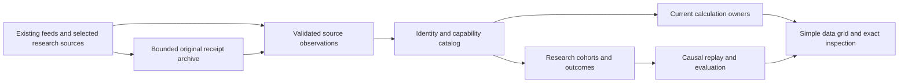

# Phase 2 implementation proposal

Build a personal research system that collects the intended data, preserves its meaning and timing, and produces inspectable, reproducible calculations. A valid result may be that available markets offer no useful trade. Public release and profitable trading are not completion requirements.

The [audit](README.md) establishes the starting point and the [archive manifest](archive.md) identifies what to retain or retire. This proposal changes priorities without starting an application rewrite or a new release funnel.

## Scope and budget

The working assumption is a $50 weekly operating envelope, with the owner's stated $30/week SGO cost leaving $20 before hosting and any other services. Whether trading bankroll is included has not been established; it is not used to define this implementation. Keep all existing provider/account/request/object guards. Their units are not interchangeable with dollars.

No additional feed, scraping subscription or higher service tier is selected here. Firecrawl is a candidate for a concrete personal-research acquisition experiment once a source gap is identified; its current capability, actual coverage, cost and timing behavior still need assessment. Internal source identity and capture records support debugging and reproduction. Public-facing sourcing/marketing work is outside this phase.

Keep the current Python/PostgreSQL stack, independent app/data processes, archive worker and simple browser interface. Use the single existing checkout on `main`. Use disposable databases for verification. Preserve private state and historical calculation versions.

## Resulting data flow



The original receipt archive provides a reprocessing path. It must not imply that every live admission waits for a full historical reparse. Browser reads continue to perform no paid acquisition.

## First implementable slice

**Restore continuous collection, expose its real state, and make the existing data easy to inspect.** Use current sources and supported markets. Finish this slice before adding subscriptions or attempting broad player-prop coverage.

Deliver:

1. A repair for the demonstrated startup-maintenance failure, with a controlled low-headroom regression and preserved SQL/disk/account guards.
2. A coverage report listing actual first/last receipt, gaps, archive verification and source health by feed. Identify the history that can support replay today.
3. An operator landing view using existing Browse/raw/details/Admin capabilities, showing all supported received prices and explicit missing/rejected calculation reasons. Keep current Opportunities as a saved view.
4. One exact example followed from retained source input through identity, reference, fees, cashflow and result, including original clocks and policy versions.

Complete local integration and proportionate engineer-led verification. Where this slice changes hosted runtime behavior, install through the existing authorized workflow and verify the deployed revision and scheduled receipt → admission → calculation → read path. The current audit itself performs no deployment.

## Ordered work

### P2 0 Reconcile the active scope

Record this direction in one active task pointer. Add historical notices/index pointers to old local product queues without moving evidence or breaking links. Preserve concrete unresolved defects and triage them against data correctness, operator usefulness and runtime reliability. Freeze new decorative/public-user work.

**Completion evidence:** one current queue, a concrete archive manifest, and no obsolete coverage, trading-month, visual redesign or public-launch requirement blocking the research POC. This is task/document reconciliation, not runtime code deletion.

### P2 1 Restore collection and measure retained coverage

Owners: `data_runtime.py`, `storage_maintenance.py`, `current_storage_policy.py`, existing archive/export/status owners.

- Identify the exact maintenance candidate and its estimated disk/SQL rewrite requirement. A sampled stack establishes the failing branch but does not name the relation.
- Make safely deferrable maintenance report its reason rather than force a restart loop. Retain genuine corruption, migration and account failures as failures; keep final admission capacity checks authoritative.
- Establish a measured disk/SQL runway policy for the current cadence and snapshot volume. Inventory unique evidence and reproducible temporary output before choosing reclamation or capacity changes. Do not purge owner state or unverified archive staging.
- Present acquisition stalled/last-received state independently of healthy web/export processes. Preserve explicit Stop/pauses.
- Census archive shards and feed gaps, including verified content, source/receipt intervals, unsupported data and known outages. Record the existing historical gap rather than pretending it is recoverable from a hash.
- For each active route, report requested, received, admitted, calculated and durably archived support separately. Unsupported archive routes remain explicit rather than appearing as zero observed history.

**Completion evidence:** deterministic low-headroom fixture; disposable SQL startup/recovery checks; unchanged protected controls; deployed runtime stays healthy across the actual maintenance/scheduled-collection transitions that exposed the problem; new admitted receipts and verified export progress. Choose observation length to cross those transitions, rather than impose an unrelated multi-hour window. No claim of complete historical coverage from an empty queue.

### P2 2 Establish the data catalog and original receipt retention

Owners: existing raw API and reference/current-row stores, transport/worker boundaries, archive owners.

Create an inspectable catalog that separates **provider**, original bookmaker/venue identity, represented execution venue, event, participant/entity, market/stat, period, exact line, outcome, scoring and settlement semantics. Retain source/receipt/knowledge timestamps, availability and revision IDs. Mark equivalence as established, ambiguous or unestablished rather than borrowing authority from a display label.

Represent observation availability, identity/matching, reference availability, fee applicability, calculation status and execution evidence separately. A missing fee can withhold net EV while preserving the received price in the research catalog. Unknown values remain null with reasons; no missing value becomes zero.

Add bounded original response retention outside normalized ingress. Store content hash, safe request scope, receipt time, parser version and normalized-output links; exclude credentials from retained request metadata. Measure compressed bytes per capture and retention cost before widening collection. Distinguish fields never requested from fields received but unsupported. Raw-receipt gaps must be visible; do not silently label data reprocessable when the receipt was skipped.

Keep quote/current SQL writes efficient. Use a small source/market capability description to centralize supported values where practical; explicit parser/semantic work still applies to genuinely new market types. Avoid building a generic plugin platform before one extension demonstrates the boundary.

**Completion evidence:** a captured response can be reparsed to the same supported identities/prices/clocks; unsupported fields remain retained and classified; missing-fee/reference cases stay inspectable; exact source/venue ambiguity is visible; byte caps and retry behavior have deterministic tests. Native raw availability and compact SGO evidence remain accurately distinguished.

### P2 3 Make calculation and probability policies explicit

Owners: `comparison/current_pregame.py`, shared valuation/cashflow/fee owners, current calculation storage/details.

Keep the existing conservative per-bet screening policy. Add a versioned coherent event/outcome probability baseline for evaluation. For the first implementation, use a complete same-book pair already present in the data. Fix the deterministic book-selection rule and fallback order before examining EV or outcomes, and select the whole pair once per exact market and cutoff. Both complementary outcomes use that same pair. This establishes reproducibility, not predictive superiority. Alternative policies can later be compared on the same frozen inputs.

Each calculation record should link to exact observation IDs, reference/model version, fee schedule/effective window, settlement-state assumptions, amount/quantity rules and result. Reuse the current exact arithmetic. Explain supported conditioning such as decisive completed-game outcomes, and keep tie/push/void assumptions explicit.

Build independent worked examples for positive, negative, zero and unavailable results. Include the audit's opposing `0.4 + 0.4` screening example to prevent a future consumer from treating independently selected references as complementary probabilities. Keep the existing journal paired-reference guard.

**Completion evidence:** exact independent arithmetic agrees; a saved record reproduces under its original policy; changing policy creates a new result without rewriting source inputs; coherent distributions sum correctly over their declared supported outcomes; unsupported settlement/fee cases remain explicit.

### P2 4 Generalize replay and research evaluation

Owners: existing archive replay, saved snapshots, journal timing/immutability patterns; a general research recorder/evaluator replacing fixed-event experiment entry points.

Define a prospective cohort before examining EV or outcomes: eligible event/market/line population, capture schedule or horizons, probability policy and evaluation cutoff. Declare one evaluation record per event, exact market/line and chosen horizon. Include nonpositive, missing, unsupported and unmatched cases in coverage accounting. Report distinct event counts alongside record counts; complementary outcomes and repeated captures are not independent samples. Millions of archive rows are not millions of independent outcome samples.

Join outcomes through canonical identities with independently recorded observation/publication times and correction history. Sporting results and venue settlement remain separate. Retain the difference between final results imported later and predictive inputs available at the decision cutoff.

Replay inputs using receipt/knowledge cutoffs. Report source gaps, missing intermediate state and historical top-only depth limitations. Recompute calculations under original or explicitly revised policies, then score probability estimates against applicable outcomes. Include Brier/log-loss and calibration/coverage reporting with sample counts and documented exclusions; compare policies on the same evaluation population. Unsupported outcomes must be counted, not dropped invisibly.

Keep evaluation assumptions and tuning data distinct from later evaluation data. Existing manually saved decisions and actual trades remain a separate optional stream. Trading returns, subscriptions and execution limitations can be measured without becoming the acceptance criterion for correct data/math.

**Completion evidence:** no future input enters an earlier replay; all selected cases reconcile to scored/missing/excluded statuses; old results survive outcome corrections; independent arithmetic and score examples pass; one real retained event completes the full chain. A prospective run establishes ongoing capture only for its actual observed scope, and no particular sample size is declared proof of profitability.

### P2 5 Finish the operator workspace

Owners: existing current frontend, Browse/game/details, raw APIs, database inspection and exports.

Use a compact table with filters for source/book, sport, event/entity, market, line, age and calculation status. Make positive opportunities an optional saved view. Open one row to inspect original record, canonical mapping, clock history, probability inputs, fee/cashflow calculation and historical comparisons. Keep collection state and Stop/budget controls easy to reach.

Start this presentation work in the first slice using existing capabilities; connect the fuller catalog, raw receipts and evaluator as they land. Avoid a fresh visual concept round. Preserve the functional behavior currently mixed into theme/layout modules before removing cosmetic code.

**Completion evidence:** the owner can inspect a good row, a negative/zero result, missing fees/reference, unmatched identity and stale/withdrawn data through the normal interface; export reproduces the same input/result revision; passive reads issue zero paid requests. Test the relevant desktop/mobile flows already supported, without making unfamiliar-user onboarding a dependency.

### P2 6 Demonstrate expansion and retire detached code

First add one additional book/reference or venue through the existing market family. Trace configuration → collection → raw retention → identity → normalized storage → reference/calculation → inspection/replay. Keep provider and venue capabilities distinct.

Then add one bounded game/player-data use case. A game-results source establishes outcome ingestion; a player-stat/prop case additionally needs player identity, stat, period, exact line, participation/void rules and outcome semantics. Select the specific source and market from an observed need and verified availability within budget. Show received-but-unsupported fields before granting a calculation capability.

If a source exposes no usable data under current access, retain that finding and validate the extension mechanics with an explicitly labeled portable capture. This is not evidence of live coverage. Do not buy broad coverage merely to demonstrate a generalized framework.

After current consumers are detached, move or retire standalone historical preview/experiment code, update package assets and test policy, and verify retained research readers. Keep applied migrations and protected data unchanged.

**Completion evidence:** the additional capability works through the same interfaces with a recorded scoped implementation change; a second source is not another bespoke dashboard; old supported identities round-trip unchanged; no current import, route or packaged asset depends on a moved file.

## Engineering requirements and recommendations

| Source | Governing effect |
| --- | --- |
| Owner direction in this conversation | Personal data/calculation proof first. Profitability and public launch are not acceptance gates. |
| Repository AGENTS instructions | One checkout on main, preserve dirty/private/account/control state, complete agreed integration and verification. |
| Existing code/storage contracts | Exact identities/clocks, immutable source/evidence, migration hash history, transactional state, missing-data semantics and quota/hold/Stop authority must remain valid. |
| Current repository CI/test policy | Use registered affected portable/SQL/client/package checks for changed owners. Deferred historical tests are not silently promoted into new release gates. |
| Audit recommendations | Bound original receipt retention, separate coherent probabilities from screening, add independent cohorts and prove one extension before broad expansion. These are proposed implementation choices. |

## Verification already completed

No application changes were required for these checks. Repeating them is justified when an implementation changes their behavior, not merely because a new document exists.

```sh
.venv/bin/python -m pytest -q \
  tests/test_sportsgameodds_adapter.py \
  tests/test_sportsgameodds_ledger.py \
  tests/test_activity_mode.py \
  tests/test_sportsgameodds_schedule.py
```

79 passed.

```sh
.venv/bin/python -m pytest -q \
  tests/test_current_pregame_reference_policy.py \
  tests/test_pregame_valuation.py \
  tests/test_pregame_arbs.py \
  tests/test_bet_journal_metrics.py \
  tests/test_odds_replay.py \
  tests/test_current_comparison_matching.py \
  tests/test_comparison_cashflows.py
```

99 passed, 24 subtests passed.

```sh
.venv/bin/python -m pytest -q \
  tests/test_ev09_asset_delivery.py tests/test_u0_display.py
```

12 passed, 6 subtests passed.

```sh
.venv/bin/python scripts/ci/postgres.py \
  --pg-config /opt/homebrew/opt/postgresql@16/bin/pg_config \
  --report-dir /tmp/predict-phase2-sql-audit \
  --tests tests/test_odds_archive_sql.py \
          tests/test_sportsgameodds_ingress_sql.py \
          tests/test_sgo_current_rows_sql.py
```

38 passed on PostgreSQL 16.15. The completed audit used a unique temporary report directory; the command above uses a reusable example destination. No owner database was used. The initial default-tool check rejected PostgreSQL 14 before creating a cluster; explicit PostgreSQL 16 resolved the tooling selection.

```sh
.venv/bin/python scripts/ci/docs.py
```

All 56 maintained documents passed. The new planning packet receives separate local-link validation. The optional historical research-loop test cannot collect without its ignored saved-page corpus; new general research fixtures should be portable/versioned.

## Expected handoff after the first slice

Show which observed source records arrived, how their identities were resolved, why calculations succeeded or remained unavailable, and how to reproduce one result. Report the installed revision, actual collection/archive continuity, gaps, costs/volume and remaining constraints. Keep local test success, deployed operation, model quality and trading results distinct.
